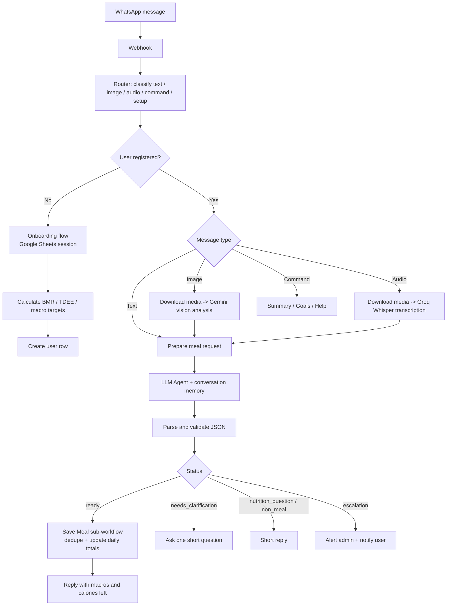

# 🥗 NoTn: WhatsApp Calorie & Macro Tracking Agent (n8n)

A conversational AI agent that lives on WhatsApp. Users send what they ate as **text, a photo, or a voice note** (Arabic / Syrian dialect), and the agent estimates calories and macros, logs the meal, and tells them how much is left for the day.

Built with **n8n**, an LLM agent, Google Sheets as a lightweight database, and WhatsApp via Evolution API.

---

## ✨ Features

- **Multimodal input**: text, food photos, and voice messages
- **Conversational onboarding**: 6 quick questions (gender, age, weight, height, goal, activity level) with validation, cancel at any time, and a confirmation step
- **Personalized daily targets** using the Mifflin-St Jeor equation and an activity multiplier
- **Structured AI output**: the agent returns strict JSON with a status, validated by code before anything is saved
- **Multi-turn context**: short answers like "four" or "large" are merged with the previous question using conversation memory
- **Duplicate protection**: the same WhatsApp message ID is never logged twice
- **Daily summary** with progress bars, plus `هدفي` (my goals) and `مساعدة` (help) commands
- **Human escalation**: if the user asks for a person or repeats an unresolved complaint, an alert is sent to an admin
- **Guardrails**: stays in the nutrition domain, ignores instructions embedded in images, never claims a meal was saved before it actually was

---

## 🏗️ Architecture

### Agent statuses

| Status | Meaning | Action |
|---|---|---|
| `ready` | User ate something and details are enough | Estimate, validate, save |
| `needs_clarification` | A missing detail changes the estimate | Ask one short question |
| `nutrition_question` | "How many calories in an apple?" | Answer, **do not log** |
| `non_meal` | Greeting or off-topic | Short reply |
| `escalation` | User wants a human | Alert the admin |

---

## 🧮 How targets are calculated

1. **BMR** (Mifflin-St Jeor): `10·kg + 6.25·cm − 5·age + 5` (male) or `− 161` (female)
2. **TDEE** = BMR × activity factor (1.2 / 1.375 / 1.55 / 1.725)
3. **Calories**
   - Loss: `TDEE − min(500, 20% of TDEE)`, with a floor of 1500 (male) / 1200 (female)
   - Maintain: `TDEE`
   - Gain: `TDEE + 250`
4. **Protein**: 2.0 / 1.6 / 1.8 g per kg (loss / maintain / gain)
5. **Fat**: 25% of calories, **carbs**: the remainder

> These are approximate estimates for general tracking, not medical advice.

---

## 🧰 Tech stack

| Layer | Tool |
|---|---|
| Orchestration | n8n |
| Messaging | WhatsApp via Evolution API |
| Reasoning / parsing | LLM through an OpenAI-compatible chat node (DeepSeek) + n8n AI Agent |
| Image understanding | Google Gemini (vision) |
| Speech-to-text | Groq Whisper `whisper-large-v3` (Arabic) |
| Storage | Google Sheets (`users` and `onboarding` tabs) |
| Memory | n8n Window Buffer Memory (per user) |

---

## 🚀 Setup

1. **Import** `workflow.json` into n8n (Workflows → Import from file).
2. **Import the sub-workflow** `Log Meal Tool` as well and point the *Save Meal* node at it. It handles saving, de-duplication, and updating daily totals.
3. **Create credentials** in n8n:
   - Google Sheets OAuth2
   - Evolution API (HTTP Header Auth)
   - LLM provider (OpenAI-compatible)
   - Google Gemini (PaLM) API key
   - Groq (HTTP Header Auth)
4. **Create the Google Sheet** with two tabs:
   - `users`: `user_id, push_name, gender, age, weight, height, goal, activity, bmr, tdee, calories_target, protein_target, carbs_target, fat_target, calories_today, protein_today, carbs_today, fat_today, calories_left, protein_left, carbs_left, fat_left, start_date, last_date, created_at, updated_at`
   - `onboarding`: `user_id, push_name, step, gender, age, weight, height, goal, activity, created_at, updated_at`
5. **Replace placeholders** in the workflow: Evolution API URL and instance name, the Google Sheet ID, and the admin WhatsApp number used by *Send Admin Alert*.
6. **Point the Evolution API webhook** to your n8n production webhook URL and activate the workflow.
7. Send any message to the WhatsApp number to start onboarding.

---

## 💬 Commands

| Message | Result |
|---|---|
| `اليوم` / `ملخص` | Today's totals, remaining macros, progress bar |
| `هدفي` | Current profile and daily targets |
| `مساعدة` | Help menu |
| anything else | Treated as a meal or a nutrition question |

---

## ⚠️ Known limitations / roadmap

- Calorie values are AI estimates, not lab-verified nutrition data. A food database lookup (e.g. USDA) would improve accuracy.
- Google Sheets is great for a prototype; PostgreSQL or Supabase would be better at scale.
- Legacy `ابدأ ...` one-line setup path still exists next to the new step-by-step onboarding and should be removed.
- Manual day reset is a stub, because the day rolls over automatically by Damascus date.
- Planned: weekly report, meal editing/deletion, English UI toggle.

---

## 👤 Author

**MHD Fadi Kalash**: IT student, building AI agents and automation workflows.
GitHub: [@fadikalash11](https://github.com/fadikalash11)
